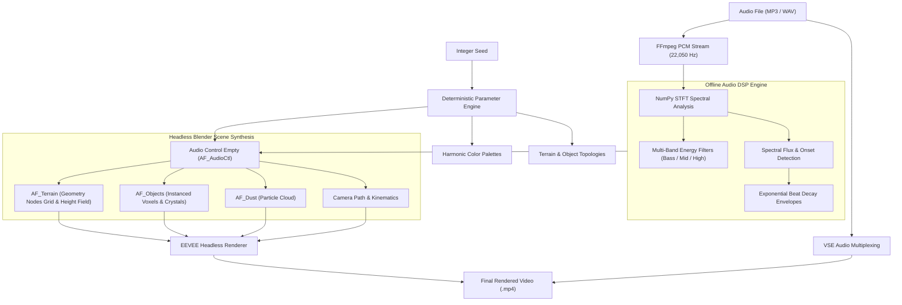

# abstract-flight

[](https://github.com/loud-thunder/abstract-flight/releases)
[](https://www.blender.org/)
[](https://www.python.org/)
[](https://numpy.org/)
[](https://ffmpeg.org/)
[](https://opensource.org/licenses/MIT)

> **A deterministic, audio-reactive procedural flight simulator and generative music video synthesizer built with Python and headless Blender.**

`abstract-flight` ingests an arbitrary audio track (e.g. MP3, WAV), performs offline multi-band spectral analysis, and synthesizes a procedural 3D world with Geometry Nodes. A camera embarks on a continuous flight down a meandering canyon carved into dynamic terrain, reactive to rhythm, frequency, and energy.

Every integer seed generates a distinct aesthetic universe—spanning color palettes, noise topographies, floating monoliths, and a continuous slider between smooth surfaces and snapped voxels—all rendered headlessly via Blender's EEVEE engine and multiplexed back with the original audio.

---

## Key Highlights

- **Deterministic Seeded Universes**: A single random seed dictates terrain noise functions (fBm, ridged, billow, terraced), color harmonies (analogous, complementary, triadic, split), object types (crystals, monoliths, spikes, rings), and procedural surface shaders.
- **Offline Audio DSP Pipeline**: Multi-band energy extraction (sub-bass, mid-range, presence/highs), log-spectral onset flux detection, and asymmetric attack/release envelopes calculated with NumPy and piped via FFmpeg.
- **Programmatic Geometry Nodes DSL**: Dynamic generation of complex Blender 4.x Geometry Node and Shader Node networks from scratch in Python via an ergonomic node-builder abstraction (`NT`), bypassing the Blender GUI entirely.
- **Continuous Smooth-to-Voxel Morphing**: Replaces rigid voxel meshing with real-time continuous vertex-snapping and dynamic column instancing, allowing landscapes and artifacts to rhythmically solidify into voxels on audio peaks.
- **Dynamic Camera Kinematics**: The camera traverses a mathematical flight corridor without raycasting. Velocity couples dynamically with low-frequency transients, banking on curves with focal length breathing (FOV pulsing) tied to perceived loudness.
- **Headless CLI Pipeline**: Production-ready command-line interface supporting headless rendering, high-speed single-frame stills, or `.blend` project file exports for manual inspection.

---

## System Architecture

The pipeline processes audio and builds the scene entirely in memory before keyframing and rendering:



---

## Technical Deep-Dive

### 1. Offline Audio DSP Analysis
To ensure frame-accurate synchronization without real-time playback bottlenecks, audio features are extracted offline:

1. **PCM Ingestion**: Audio is decoded into 32-bit floating point monophonic PCM at 22,050 Hz using an FFmpeg subprocess pipe.
2. **Short-Time Fourier Transform (STFT)**: A 2048-sample Hanning window computes frequency bins partitioned into three primary psychoacoustic bands:
   - **Sub-Bass / Bass** (20 Hz – 150 Hz): Drives terrain amplitude and camera forward velocity.
   - **Mid-Range** (150 Hz – 2,000 Hz): Modulates structural formations and shader displacements.
   - **Highs / Presence** (2,000 Hz – 10,000 Hz): Drives emission brightness, particle dust energy, and contour lines.
3. **Spectral Flux & Beat Tracking**: Onset detection measures half-wave rectified spectral flux across consecutive frames:
   $$\text{Flux}[i] = \sum \max\left(\log(1 + 10 \cdot S_i) - \log(1 + 10 \cdot S_{i-1}), 0\right)$$
   Peaks exceeding an adaptive moving threshold trigger instantaneous beat attacks with exponential decay ($\approx 0.2\text{ s}$).
4. **Keyframe Baking**: Extracted envelopes (`bass`, `mid`, `high`, `onset`, `loud`, `beat`) are keyframed onto the location and scale transforms of a single control empty (`AF_AudioCtl`). Both Geometry Node graphs and Shader Node graphs bind directly to these channels.

### 2. Procedural Geometry & Continuous Voxelization
Rather than generating a traditional rigid voxel lattice, `abstract-flight` implements continuous smooth-to-voxel morphing:

- **Vertex Quantization**: Vertices smoothly interpolate between continuous height fields and discrete step lattices using continuous vector snapping where $\alpha \in [0, 1]$ is dynamically driven by the instantaneous audio band envelope.:

$$\vec{p}_{\text{snapped}} = \text{round}\left(\frac{\vec{p}}{s}\right) \cdot s$$

$$\vec{p}_{\text{out}} = (1 - \alpha) \cdot \vec{p} + \alpha \cdot \vec{p}_{\text{snapped}}$$
  
  
- **Instanced Column Generation**: For higher voxelization thresholds, point grids instance 3D cubic columns whose heights match the snapped terrain height, seamlessly combining smooth terrain with stepped voxel monoliths.
- **Flight Corridor**: The terrain height field carves out an analytic meandering valley defined by:
  $$x_{\text{center}}(y) = A \cdot \sin(f \cdot y + \phi)$$
  Ensuring the camera always maintains clear line of sight through canyons without expensive collision checks or mesh raycasting.

### 3. Programmatic Node Tree Metaprogramming
Creating complex Geometry Node graphs via the Blender Python API is notoriously verbose. `abstract_flight.py` introduces a lightweight node builder class (`NT`):

```python
class NT:
    """Concise builder DSL over Blender node trees."""
    def make(self, idname, inputs=None, **props): ...
    def m(self, op, a, b=None, c=None, clamp=False): ...  # ShaderNodeMath
    def v(self, op, a, b=None, scale=None): ...           # ShaderNodeVectorMath
    def rng(self, val, a, b, c, d, smooth=False): ...     # ShaderNodeMapRange
    def lerp(self, a, b, t): ...
    def comb(self, x, y, z): ...
```

This abstraction allows declarative composition of multi-octave noise, coordinate transformations, and material driver hookups in clean Python syntax.

### 4. Dynamic Camera Kinematics
The camera motion mimics an acrobatic drone pilot responding to the music:
- **Velocity Coupling**: Base forward velocity scales proportionally with instantaneous bass energy:

  $$v(t) = v_{\text{base}} \cdot \left(0.6 + k_{\text{bass}} \cdot E_{\text{bass}}(t) + 0.3 \cdot E_{\text{loud}}(t)\right)$$
  
- **Adaptive Banking & Yaw**: Camera yaw aligns with the tangent of the meander curve ($$\arctan(-\nabla x)$$), while roll (banking) is derived from the second derivative (curvature) to lean naturally into turns.
- **Focal Breathing**: The camera lens dynamically shifts between wide-angle ($22\text{ mm}$) and ultra-wide ($14\text{ mm}$) based on RMS loudness, exaggerating depth and speed on drop sections.

---

## Tech Stack

| Layer | Technology | Role |
|---|---|---|
| **Audio Processing** | Python, NumPy, FFmpeg | Offline STFT spectral decomposition, flux onset calculation, envelope filtering |
| **Generative 3D** | Blender 4.x (`bpy`) | Geometry Nodes, procedural mesh synthesis, dynamic instancing |
| **Shading & Lighting** | Blender Shader Nodes | Audio-driven emission shaders, procedural Voronoi/Noise texturing, Bloom glare compositing |
| **Renderer** | Blender EEVEE / EEVEE Next | High-speed real-time PBR rasterization, headless batch rendering |
| **Encoding** | FFmpeg (via Blender VSE) | Video muxing, H.264 video compression, AAC audio encoding |

---

## Quickstart

### Prerequisites

- **Blender 4.0+** (accessible in PATH or via `/Applications/Blender.app/Contents/MacOS/blender` on macOS)
- **FFmpeg** installed and accessible in system PATH
- **Python with NumPy** (typically bundled with Blender's internal Python)

### Basic Usage

Generate and render a music video from an audio track:

```bash
blender -b -P abstract_flight.py -- --audio track.mp3 --seed 42 --out render/flight.mp4
```

### CLI Recipes

**Render a quick 10-second preview (300 frames at 30 fps):**
```bash
blender -b -P abstract_flight.py -- \
  --audio track.mp3 \
  --frames 300 \
  --res 1280x720 \
  --out render/preview.mp4
```

**Render a high-resolution 4K still frame (frame 150):**
```bash
blender -b -P abstract_flight.py -- \
  --audio track.mp3 \
  --seed 128 \
  --still 150 \
  --res 3840x2160 \
  --out render/still_frame.png
```

**Generate and save the `.blend` file without rendering (for Blender UI inspection):**
```bash
blender -b -P abstract_flight.py -- \
  --audio track.mp3 \
  --seed 7 \
  --save-blend scene.blend \
  --no-render
```

---

## CLI Reference

All options are passed after `--` in the Blender invocation:

| Argument | Type | Default | Description |
|---|---|---|---|
| `--audio` | `str` | *(Required)* | Path to the source audio file (MP3, WAV, FLAC, etc.) |
| `--seed` | `int` | `1` | Integer seed controlling all procedural generation choices |
| `--out` | `str` | `render/abstract_flight.mp4` | Destination filepath for the output video or still image |
| `--fps` | `int` | `30` | Render framerate (also dictates DSP hop size) |
| `--res` | `str` | `1920x1080` | Output resolution formatted as `WIDTHxHEIGHT` |
| `--samples` | `int` | `32` | EEVEE TAA render samples per frame |
| `--save-blend` | `str` | `None` | Path to save the generated Blender project file (`.blend`) |
| `--frames` | `int` | `0` (all) | Limit rendering to the first *N* frames (useful for testing) |
| `--still` | `int` | `None` | Frame index to render as a single PNG image to `--out` |
| `--no-render` | `flag` | `False` | Skip rendering stage entirely (used with `--save-blend`) |

---

## License

This project is licensed under the MIT License - see the [LICENSE](LICENSE) file for details.
